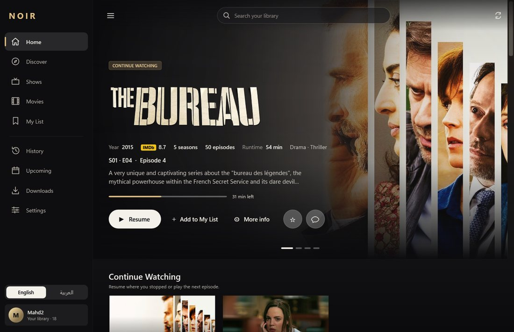
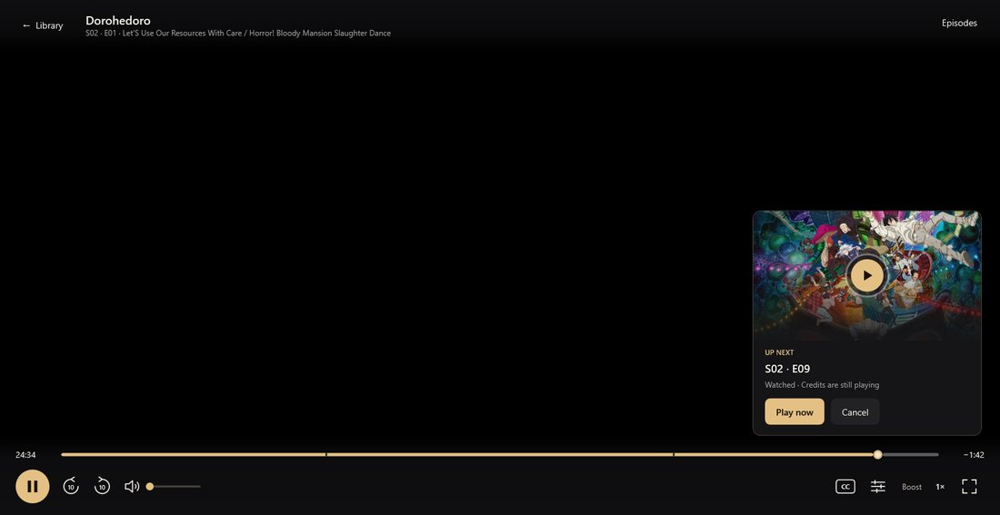
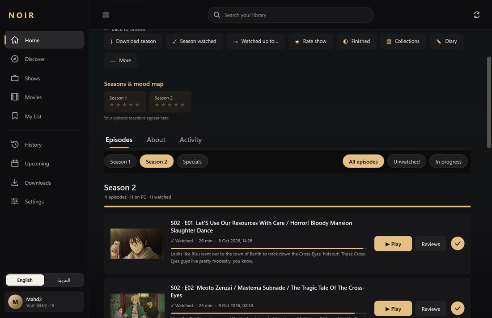
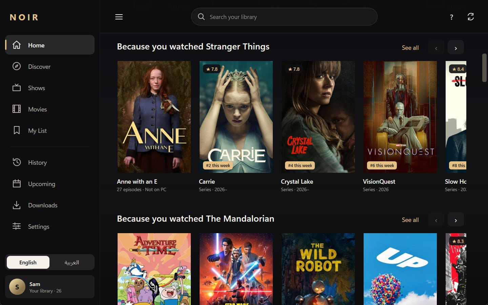
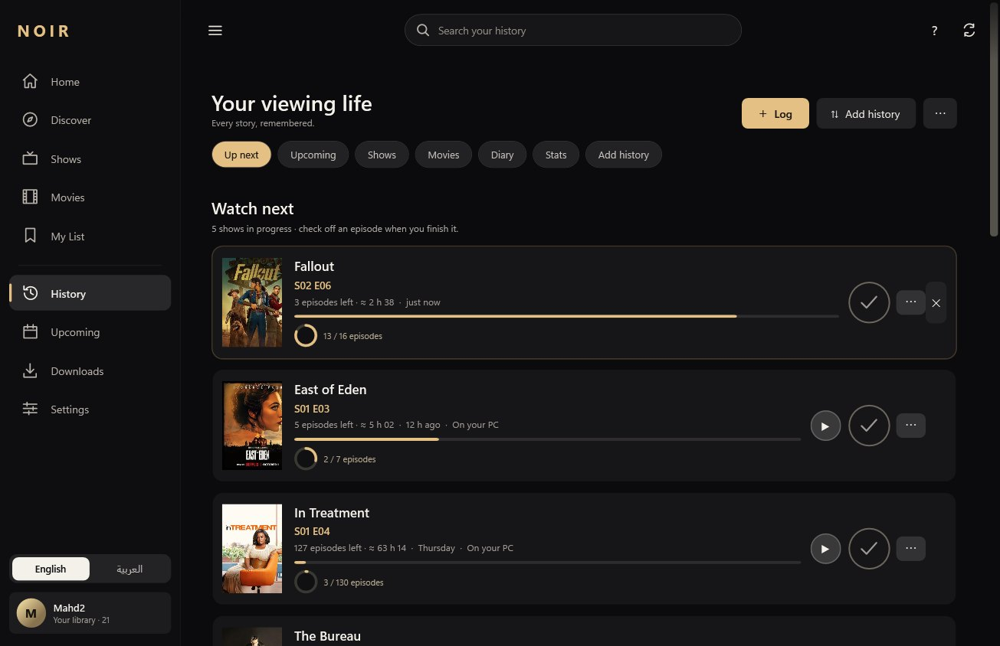
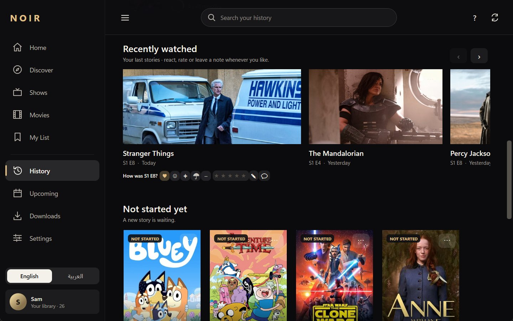
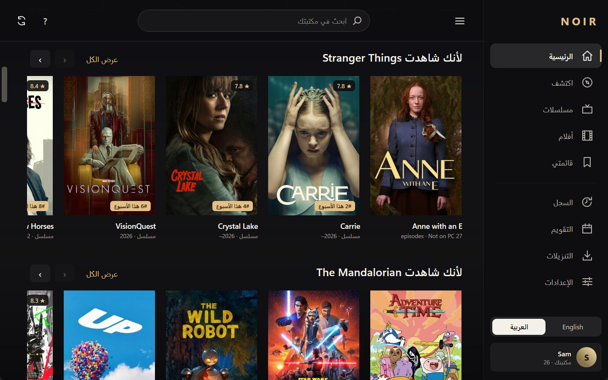
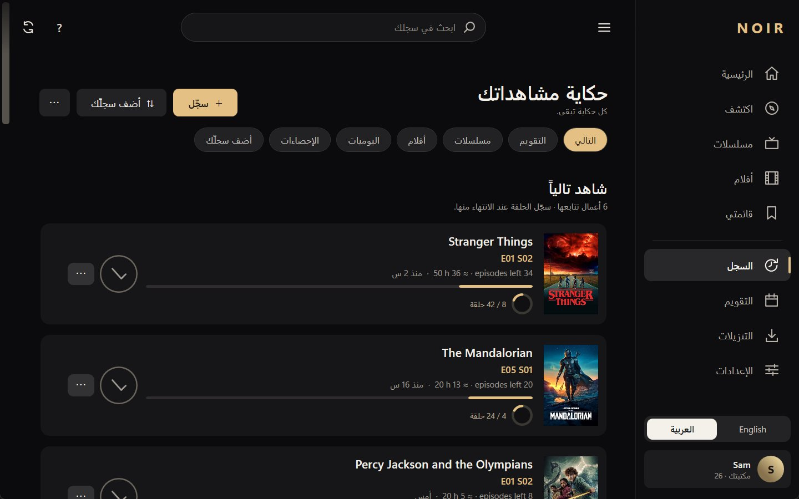

# Noir

**A place for everything you watch.**

Settle into a film, pick up a series, or remember something you watched somewhere else.
Noir brings your player, movie and TV library, and watch diary together on Windows
and Android phones, with a Google TV / Android TV app for the sofa.

[**Download Noir**](https://github.com/Yaqoubj/Noir/releases/latest) · Windows 0.17.0 · Android 0.10.0 · free and open source

## Make yourself comfortable

Point Noir at your movie and show folders on Windows, or stream through your own
AIOStreams connection. VLC powers playback on PC, phone and TV, with saved resume
points that let you leave an episode halfway through and come back to it.

- Choose audio tracks and subtitles, including English and Arabic subtitle downloads
  when available.
- Skip known intros, recaps and credits; let Up Next take you into the following
  episode, or cancel it.
- Save movies and episodes for offline viewing on PC and phone, with downloads
  managed inside Noir.

Streaming and downloads use your configured sources, including AIOStreams, TorBox
and Real-Debrid, with each service's own connection and account requirements.

## A library worth browsing

Browse your folders as a library of posters, artwork, seasons and episode pages,
with title synopses and cast, **My List** for things you want to watch,
and collections you put together yourself.

Home mixes **Continue Watching** with recommendations drawn from what you watch,
rate and favourite. Discover lets you search movies and shows beyond your library;
you can save a title without downloading it or marking it watched.

- Find something through popular picks, genres, or suggestions based on your favourites.
- Let smart lists surface unfinished shows, comfort rewatches and shorter choices
  for tonight.
- Arrange Home's rows around the way you browse.

## Your whole viewing life

From a film at the cinema to a series on another service, Noir can be your watch
tracker without a media folder: search a title, choose when you watched it,
and log a movie, an episode or a season.

**Up next** keeps your place across the shows you follow, with a quick check-off
for each episode, while your diary keeps viewing dates and rewatches.
History, ratings, favourites and private notes stay with you even when the video
files are gone.

- See what's coming in the episode calendar, with air dates when available and
  optional alerts.
- Look back through watch-time stats, streaks and a year in review you can save
  as story images.
- Rate or leave a note from Recently watched, whenever you feel like it.

## Bring your history with you

Bring your records into Noir and keep them alongside what you watch here,
without having to remember every episode you've seen.

- **Import exports** from Netflix, Trakt, TV Time and Letterboxd, IMDb ratings,
  Simkl backups, or a CSV of your own.
- **Connect your other libraries:** pull watched titles from Stremio, Plex,
  Jellyfin, Emby or Kodi; Nuvio can exchange watched status in both directions.
- **Review file imports before adding them.** Re-imports skip duplicate viewings,
  and an import can be undone.

Imports and exports are available on Windows and phone; Kodi imports on the phone
use a paired PC. Export your diary as Noir CSV/JSON, Letterboxd CSV or Trakt JSON.

## From your desk to the sofa

Browse, track, stream and download on the phone without a PC, or pair your phone
or TV with Windows Noir over your home network to share watch history, resume points,
ratings and My List with the linked PC profile.

- **On your phone:** play completed downloads offline, or stream files from your
  PC while it is reachable.
- **On your TV:** browse and play with the remote, using your own AIOStreams link
  or a paired PC.
- **For later:** choose shows to **Keep ready**, with automatic episode downloads
  within a storage budget you set on PC or phone.

Keep Noir running on the PC for local sync and PC-file streaming.
The phone saves offline progress for the next connection; its own streams and
completed downloads can play with the PC off.

## Yours to keep

Your library, history, private ratings and notes are saved locally, with device
sync directly over your home network and no Noir account or cloud account required.
Separate profiles give each person their own library and viewing record.

- Back up your history, lists, settings and artwork in a `.noirbackup` file on
  Windows, and restore it in Noir.
- Windows can also make automatic weekly backups.
- Backups leave out video files, passwords and browser sign-ins.

Online discovery, subtitles and optional service connections use their respective providers.

## بالعربية أيضًا

**أفلامك ومسلسلاتك وسجلّ مشاهداتك، في مكان واحد.**

Choose English or Arabic, with right-to-left browsing layouts and support for Arabic subtitles.

## Get started

1. [Download Noir](https://github.com/Yaqoubj/Noir/releases/latest). On Windows,
   unzip the package and run **Noir.exe**; on Android, install the phone or TV APK
   for your device.
2. Make it yours: add your media folders on Windows, search and log what you've
   watched, or import an existing watch history. The phone works without pairing.
3. Connect what you want: add your AIOStreams link in download settings for
   streaming, or use Windows **Settings → Phone → Pair a phone or TV** for
   local device sync.

[Windows guide and building](Noir/README.md) · [Android guide and building](Noir.Android/README.md) · [MIT license](LICENSE)
