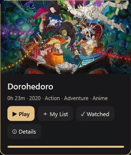
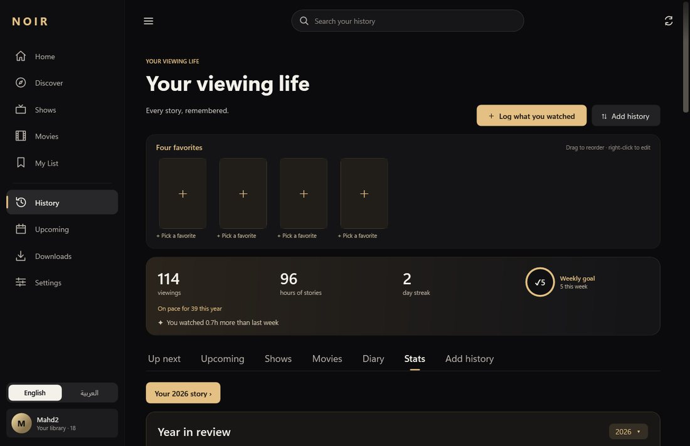
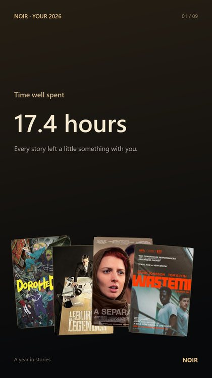

# Noir

**A personal cinema and watch tracker for Windows and Android.** Play your own files or streams, and keep your whole viewing history in one place.

[**Download Noir**](https://github.com/Yaqoubj/Noir/releases/latest) · Windows 0.15.1 · Android 0.7.1

## Highlights

- **Track everything.** Log any show or movie, check off episodes, rate with half stars, and pick four favorites. You can also import from Netflix, Trakt, TV Time, Letterboxd, IMDb, Plex, Jellyfin, Kodi and more.
- **Watch here.** Play local files or streams from AIOStreams (TorBox / Real-Debrid) in a VLC-based player with English and Arabic subtitles.
- **Phone and PC together.** Profiles, history, ratings and resume points sync over home Wi‑Fi. The phone also works on its own.

## Player

- An Up Next card with a countdown ring, and a "Still watching?" check.
- Skip intros, recaps and credits automatically or with a button, each with Undo.
- Chapter marks on the seek bar, speed from 0.5× to 2×, and a volume boost up to 200%.
- Thumbnails while scrubbing, on PC and phone.

## Browsing and detail pages

- Hover cards that expand with a muted trailer or clip. Previews can be turned off.
- Labels such as "New season" and "Finale".
- Discover opens a quick side panel (a bottom sheet on the phone).
- Home rows you can reorder and hide; Continue Watching always stays first.
- Poster, landscape or list views.
- Cast and crew with person pages, plus trailers and extras.

 

## Noir knows you

Every feature here works on both Windows and Android.

- **Keep ready:** Noir keeps the next episodes of your shows downloaded, using only sources your service already has ready.
  - It stays within a storage budget and never deletes an unwatched episode.
  - Removing watched episodes after 7 days is optional.
  - The phone downloads overnight, only on Wi‑Fi while charging.
  - The phone can also bring over what you started on the PC: your unfinished episodes and movies are copied over home Wi‑Fi so you can finish them anywhere.
- **Smart lists:** Home rows that build themselves: Unfinished business, Comfort rewatches, Directors you love, and Short tonight. Each title says why it's there.
- **Catch me up:** coming back to a show after a break shows a short recap of the last episodes you watched, never anything past where you stopped.
- **Compare taste:** share a QR code or a `noir://taste` link with a friend to see how well your tastes match, what you both loved, and what they loved that you haven't seen.
  - You review exactly what's included before sharing.
  - Nothing is uploaded.

## History

- **"Your viewing life":** streaks, a weekly goal with neutral pacing, a diary with hearts and half stars, and season ratings with a mood map.
- **Year in review:** shareable story slides, each one saved as a PNG.
- **On the phone:** an Android home-screen widget for the next episode, with a ✓ check-off.
- **Upcoming:** an Upcoming calendar with alerts and `.ics` export.

 

## Get started

1. Run **Noir.exe** and choose **Track what I watch** or **Play my files**.
2. Install the Android APK. Optionally pair it in **Settings → Phone Sync**.
3. Optionally add TorBox or Real-Debrid and AIOStreams in **Settings → Downloads**.

[Windows guide & building](Noir/README.md) · [Android guide & building](Noir.Android/README.md) · [MIT license](LICENSE)
