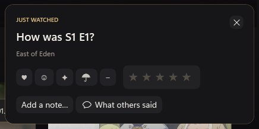

# Noir

**Your own little cinema, and a diary of everything you've ever watched.**

Noir plays your files and streams on Windows, Android phones and Google TV, and quietly remembers every episode and movie along the way, even after the files are long gone.

[**Download Noir**](https://github.com/Yaqoubj/Noir/releases/latest) · Windows 0.17.0 · Android 0.9.0 · free and open source

## Why Noir?

Most players forget you the moment you close them. Most trackers make you do all the typing. Noir does both jobs in one place:

- **It plays.** Local files, or streams through AIOStreams with TorBox or Real-Debrid, in a fast VLC-based player with English and Arabic subtitles.
- **It remembers.** Every check-off, rating, rewatch and note lands in your history automatically, and you can bring in years of history from Netflix, Trakt, TV Time, Letterboxd, IMDb, Plex, Jellyfin, Kodi and more.
- **It follows you.** Your PC, phone and TV share profiles, history and resume points over home Wi‑Fi. No account, no cloud, and the phone works fine on its own.

## A Home that knows what you're in the mood for

Open Noir and the next thing to watch is right there. Below it, rows that actually fill up with things worth your time:

- **Continue watching** on wide cards that show the episode and how many minutes are left.
- **Top 10 this week**, straight from Cinemeta.
- **Because you watched…**, two rows of picks from your own library first, then fresh titles you haven't seen.
- **Picked for you** and **More like your favourites**, each card telling you *why* it's there.
- **Popular** and **Top rated** in the genre you watch most.

Hover over any card and the big hero at the top changes to that title, so you can browse without clicking into every page. Rows end with a **See all** tile, and **Edit Home** lets you reorder, hide or restyle any of them.

- Hover cards that grow into a muted trailer or clip (you can turn previews off).
- Labels like "New season" and "Finale" so nothing slips by.
- A quick Discover side panel (a bottom sheet on the phone).
- Poster, landscape or list views for your library.
- Cast and crew with person pages, plus trailers and extras.

 

## History, the way you'd actually use it

History opens on what matters: **Up next**, every show you're in the middle of, with a big check circle for the episode you just finished.

Right below it is **Recently watched**, so last night's episode is never more than a scroll away.

- **Favourites** without limits: tap ♡ on any card or title page, and pick your **Top four** for your profile.
- **Stop showing** a show you've dropped, straight from its ⋯ menu. It leaves Up next, and **Bring back** is one click away if you change your mind. Everything has Undo.
- Streaks, a weekly goal and your yearly pace live in a slim strip at the bottom: there when you want them, never in your face.
- A **diary** with hearts and half stars, season ratings with a mood map, and an **Upcoming** calendar with alerts and `.ics` export.

- **Year in review:** shareable story slides, each saved as a PNG.
- **On your phone's home screen:** a widget for the next episode, with a ✓ to check it off.

 

## "How was it?" (only if you want to say)

When you finish an episode or a movie, a small card slides into the corner. React with one tap, rate it, jot a quick note, or open **What others said** to read the Reddit discussion and reviews for that exact episode.

It never pops up mid-binge, it disappears on its own after a few seconds, and if you ignore it five times in a row Noir takes the hint and stops asking. You can always do it later from Recently watched, or choose *Always*, *Finales and movies only* or *Never* in Settings → History.

 

## The player

- An Up Next card with a countdown ring, and a gentle "Still watching?" check.
- Skip intros, recaps and credits automatically or with a button, each with Undo.
- Chapter marks on the seek bar, speed from 0.5× to 2×, and a volume boost up to 200%.
- Preview thumbnails while scrubbing, on PC and phone.
- Subtitles that fix their own timing, including the ones built into the video.

## Noir knows you

- **Keep ready:** the next episodes of your shows are always downloaded and waiting, within a storage budget you set. Watched episodes can clean themselves up after a week; unwatched ones are never deleted. The phone downloads overnight, on Wi‑Fi, while charging, and can bring over whatever you left unfinished on the PC.
- **Smart lists:** rows that build themselves: Unfinished business, Comfort rewatches, Directors you love, Short tonight.
- **Catch me up:** coming back after a break? You get a short recap of the last episodes you watched, and never a spoiler past where you stopped.
- **Compare taste:** share a QR code or a `noir://taste` link with a friend and see how well your tastes match. You see exactly what's shared, and nothing is uploaded.

## On your TV

Noir also runs on Google TV and Android TV, built for the remote. It picks streams your TV can actually play smoothly and switches to another if one stalls. Pair it with your PC using a short code shown on screen.

## Get started

1. Download the latest release, unzip it and run **Noir.exe**. Choose **Track what I watch** or **Play my files**.
2. Install the Android APK on your phone (and the TV APK on your TV if you like), then pair them from **Settings → Phone** on the PC. Pairing is optional; the phone works on its own too.
3. Want streaming? Add TorBox or Real-Debrid and your AIOStreams link in **Settings → Downloads**.

Noir speaks English and Arabic, right-to-left layout included.

[Windows guide and building](Noir/README.md) · [Android guide and building](Noir.Android/README.md) · [MIT license](LICENSE)
